# Crazyflie 2.1: Flight Control, Telemetry Logging & 3D Visualisation

Python control and telemetry for a [Bitcraze Crazyflie 2.1](https://www.bitcraze.io/products/crazyflie-2-1/) nano-quadcopter, plus the surrounding experiments from an internship at **NESCOM** (National Engineering and Scientific Commission): hardware assembly, a MATLAB/Simulink flight simulation, UWB indoor positioning with the Loco Positioning System, and ROS 2 / RViz2 visualisation.

> **Authors:** Amna Ahmad (EE-19, Institute of Space Technology) · **Supervisor:** Dr. Raheel Quraishi
> Full write-up: [`docs/internship_report.pdf`](docs/internship_report.pdf)

<!-- Add one line on what YOU personally did, if the work was split. -->

<p align="center">
  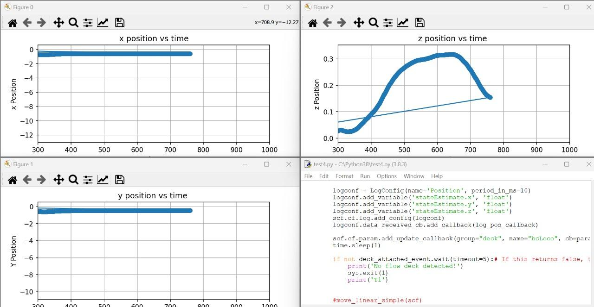
  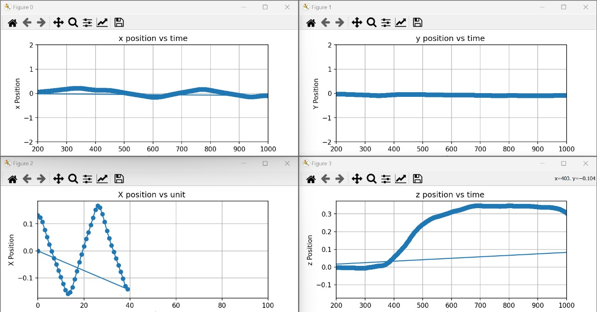
</p>


## What this project covers

| Stage | What was done | Tools |
|---|---|---|
| 1. Assembly | Built the Crazyflie from its kit and verified it with the power-on self-test and motor spin test | Crazyflie 2.1 kit |
| 2. Manual flight | Flew it from a phone over Bluetooth LE to check for flight bugs | Crazyflie mobile app |
| 3. PC client | Connected through the CF Client for live monitoring, takeoff and landing | `cfclient`, Crazyradio PA |
| 4. Simulation | Simulated the quadcopter's response to z / roll / pitch / yaw reference signals | MATLAB R2017b, Simulink |
| 5. Indoor positioning | Set up UWB anchors and tracked the drone in a 3D room view | Loco Positioning System |
| 6. ROS 2 | Connected the drone to ROS 2 and visualised it in RViz2 | ROS 2 Humble, crazyswarm2 |
| 7. Python API | Scripted connection, deck checks, logging, parameters and autonomous flight, then plotted the data | Python 3.8, `cflib`, Matplotlib |

## System overview

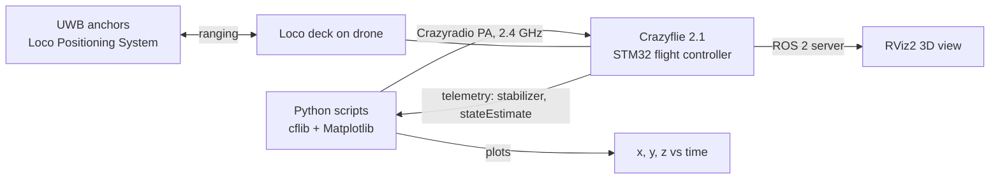

## Scripts (`src/`)

| Script | What it does |
|---|---|
| `connect.py` | Opens a radio link to the drone and confirms the connection with a callback |
| `takeoff.py` | Checks that the required deck is attached, then takes off to 0.3 m, holds for 2 s and lands |
| `logging_sync.py` | Synchronous logging of roll, pitch and yaw at a 10 ms period (10 samples, then disconnect) |
| `logging_async.py` | Asynchronous logging with a callback, so data streams while the main loop does other work. Stops on Ctrl+C. |
| `parameter_control.py` | Reads a parameter (`stabilizer.estimator`), changes it, and confirms the update through a callback |
| `flight_logging.py` | Flies with `MotionCommander` while logging `stateEstimate.x/y/z`, then plots each axis |
| `box_flight.py` | Autonomous flight that stays inside a ±0.2 m box using position feedback |

## Results

**Hover test.** After takeoff the logged z-position rises to the 0.3 m target, holds for a couple of seconds and falls back on landing, while x and y stay essentially flat.

**Box-limited autonomous flight** (`BOX_LIMIT = 0.2 m`, maximum 0.2 m/s, 70 control steps at 0.1 s). The script reads the live position estimate and reverses the velocity command whenever the drone crosses a boundary. The logged x-position oscillates within roughly ±0.15 m, inside the limit, with height steady near 0.3 m.

**Telemetry at rest** (10 ms log period): roll ≈ 0.11°, pitch ≈ −0.47°, yaw ≈ 0.62°.

**Parameter write.** `stabilizer.estimator` was read as 2, set to 1, and the update callback confirmed it (2 = Kalman and 1 = complementary in Bitcraze's firmware).

**Loco Positioning System.** With six anchor nodes set up in a room, the drone was placed beside anchor 1 and the CF Client plotted its position at that anchor in the 3D view.

**ROS 2.** The Crazyflie (`cf231`) connected through a Crazyradio PA to the crazyswarm2 server and appeared as a live frame in RViz2.

<p align="center">
  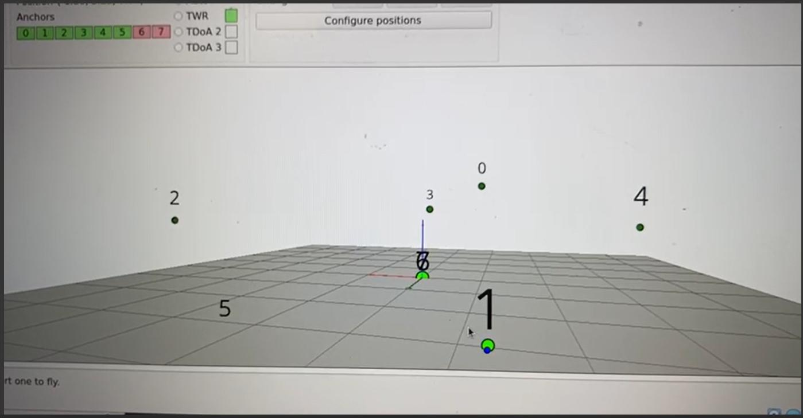
  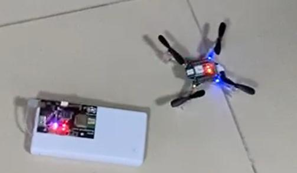
  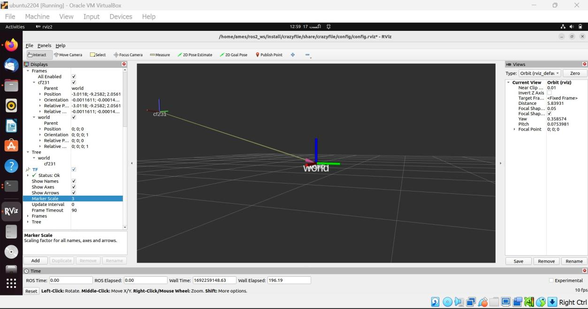
</p>

### Script output

<p align="center">
  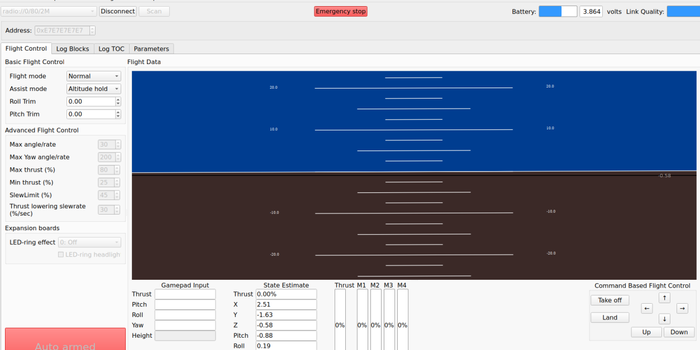
  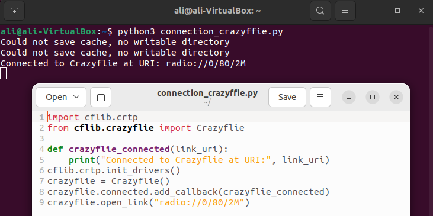
</p>
<p align="center">
  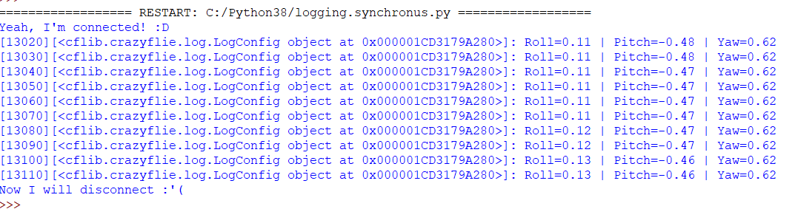
  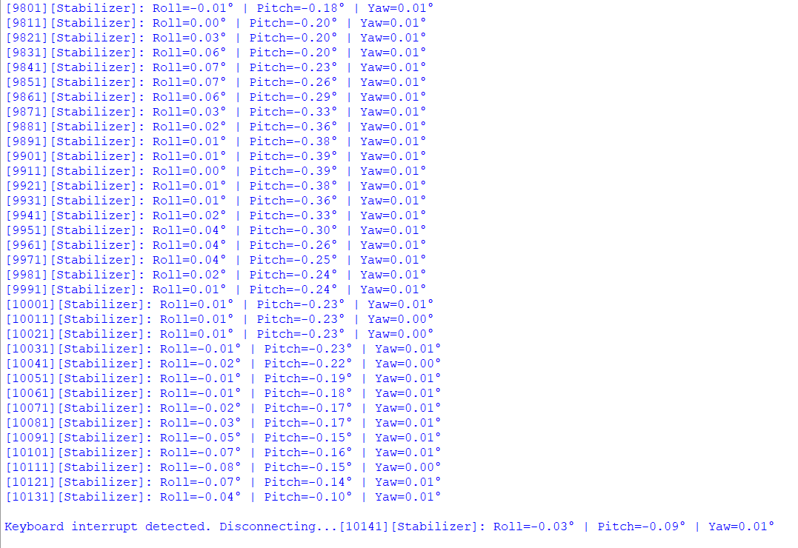
</p>
<p align="center"><sub>CF Client, connection test, and synchronous (left) and asynchronous (right) stabilizer logging.</sub></p>

### Simulation (MATLAB / Simulink)

Using the open Simulink quadcopter model by Wookshik Kim, with the Crazyflie's estimated physical parameters (mass 0.03097 kg, moments of inertia of about 1.11×10⁻⁵, 1.11×10⁻⁵ and 2.16×10⁻⁵ kg·m²), the drone's response was simulated for step and pulse reference signals on z, roll, pitch and yaw. The model uses a nested PID attitude controller (with the firmware's gains) driven by PWM in the 16-bit range (max 65 535), and a simple PID position controller that turns x/y errors into roll and pitch references.

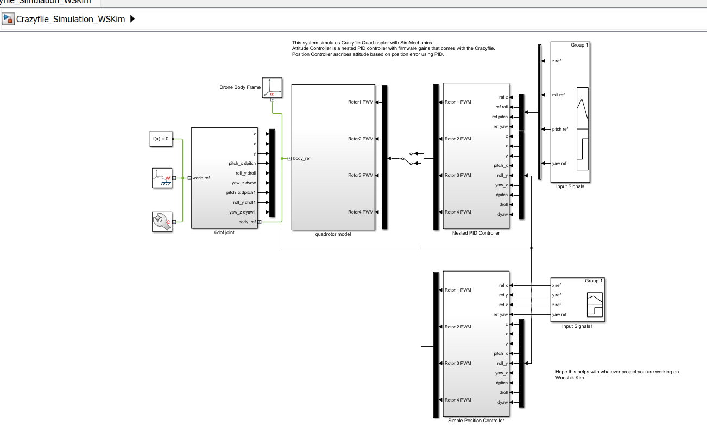

## Hardware and software

- Crazyflie 2.1, Crazyradio PA, **Loco Positioning deck** and UWB anchor nodes
- Ubuntu 20.04 and 22.04 (CF Client, ROS 2 Humble), Python 3.8 and 3.7+ for the client, MATLAB R2017b
- Python packages: `cflib`, `matplotlib`

> **Note on decks:** the experiments used the Loco Positioning deck for position estimation (the scripts wait for `deck.bcLoco`). If you fly with a Flow deck, check `deck.bcFlow2` instead. The Flow and Multi-ranger decks were not available during the project.

## Getting started

```bash
git clone https://github.com/amnaahmad43200/crazyflie-flight-control.git
cd crazyflie-flight-control
pip install cflib matplotlib
```

1. Plug in the Crazyradio PA and power on the Crazyflie. (On Linux you may need Bitcraze's udev rules for USB access.)
2. Set your drone's address. The scripts default to `radio://0/80/2M/E7E7E7E7E7`, or set it with the `CFLIB_URI` environment variable.
3. Test the link, then log, then fly:

```bash
python src/connect.py
python src/logging_sync.py
python src/takeoff.py
python src/box_flight.py
```

> ⚠️ **Safety:** fly in a clear indoor space, keep the battery charged, start with `takeoff.py` at low height, and be ready to cut power. The deck check exists so the drone only takes off when its positioning hardware is detected.

## What I learned

- **Thrust-only manual control drifts.** When flown with thrust alone, the drone climbed in proportion to thrust but also moved forward because its weight is not perfectly balanced, which is why closed-loop position control matters.
- **Synchronous vs asynchronous logging.** Synchronous logging blocks until data arrives and is fine for short checks; asynchronous callbacks let you log continuously while commanding flight.
- **Fail safe before takeoff.** Reading deck parameters first and aborting if the deck is missing avoids flying without position feedback.
- **UWB positioning trade-offs.** Two-Way Ranging (about 6 anchors, one tag at a time), TDoA 2 (about 8 anchors, multiple tags) and TDoA 3 (scalable, robust to anchor changes).
- **Tooling reality.** ROS 2 SLAM mapping was not possible because the Flow and Multi-ranger decks were unavailable.

## Known limitations

- The "box flight" is a **bounded back-and-forth flight** that reverses at ±0.2 m, not a tracked square trajectory.
- Tracking accuracy was inspected visually from plots and **not quantified** (no error metric against a ground truth).
- Flight control relies on the firmware's built-in PID controllers; no custom controller was implemented on the drone.
- In the report listings, position logs are stored in fixed-size lists, which would overflow on long flights. Using `append()` or a `deque` is safer.

## Next steps

- Quantify position error against anchor-surveyed waypoints.
- Fly a true square or waypoint trajectory with `PositionHlCommander`.
- Add Flow and Multi-ranger decks to enable ROS 2 SLAM mapping.
- Implement and tune a custom controller; extend to multi-drone flight with crazyswarm2.

## Project structure

```
crazyflie-flight-control/
├── src/                 # Python scripts (table above)
├── results/
│   ├── plots/           # Logged position plots
│   └── screenshots/     # CF Client, RViz2, Simulink, terminal output
├── docs/
│   └── internship_report.pdf
└── README.md
```

## References

- [Crazyflie 2.1 product page](https://www.bitcraze.io/products/crazyflie-2-1/) · [Getting started](https://www.bitcraze.io/documentation/tutorials/getting-started-with-crazyflie-2-x/)
- [cflib documentation](https://www.bitcraze.io/documentation/repository/crazyflie-lib-python/master/) · [Connect, log and params](https://www.bitcraze.io/documentation/repository/crazyflie-lib-python/master/userguides/sbs_connect_log_param/)
- [CF Client installation](https://www.bitcraze.io/documentation/repository/crazyflie-clients-python/master/installation/install/) · [User guide](https://www.bitcraze.io/documentation/repository/crazyflie-clients-python/master/userguides/userguide_client/)
- [LPS node configuration](https://www.bitcraze.io/documentation/repository/lps-node-firmware/master/userguides/configure-mode/)
- [crazyswarm2 (ROS 2)](https://imrclab.github.io/crazyswarm2/overview.html)
- [Crazyflie quadcopter simulation (MATLAB File Exchange, Wookshik Kim)](https://www.mathworks.com/matlabcentral/fileexchange/65469-crazyflie-quadcoptersimulation-using-simmechanics)

## Acknowledgements

Supervisor Dr. Raheel Quraishi; NESCOM for equipment and resources; the Institute of Space Technology for laboratory access.


